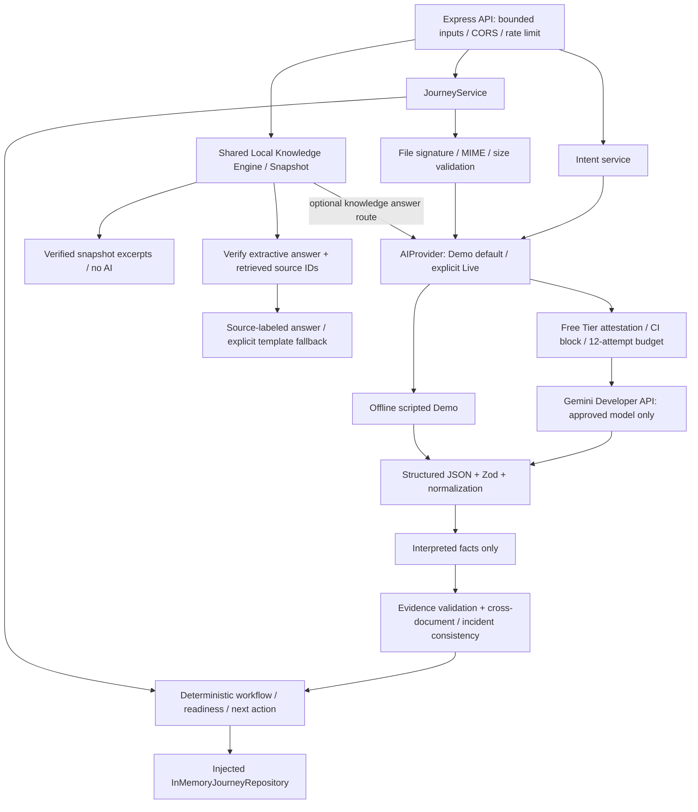

# NAVI — 目前架構（Developer B Phase 4C Shared Knowledge）

**AI interprets. The system decides.** NAVI is a service navigation layer, not an insurer's eligibility or claim submission system. The mock insurance website is a separate application.

## Implemented backend



`apps/api/src/services/gemini.service.js` implements the provider interface with native fetch, not a Google SDK imported into controllers. `ai/prompts/` holds separate system instructions. `ai/schemas.js` validates model-only outputs; `shared/intelligence.js` and `shared/journey.js` define public contracts. The model cannot supply scores, workflow stages or actions. Missing facts remain null.

Demo is the default; ordinary dev scripts force Demo. Live requires an explicit command and `GEMINI_FREE_TIER_CONFIRMED=true` after a human verifies the project has no Billing. The tool cannot verify billing from an API Key. CI cannot call live AI. All attempts, including retries, share a hard 12-request budget per provider/process; no automatic reset or paid fallback. 429 backs off once, then stops live evaluation. Quota/guard failures are not hidden by wording fallbacks.

The only approved live model is `gemini-3.5-flash-lite`, configured centrally. A single 10-second deadline covers at most two attempts. Live intent/document failures return safe API errors and leave the stored Journey unchanged. Only non-critical knowledge/handoff wording can use the actual retrieved/known-fact template, explicitly labeled.

所有 Backend Journey 不留原始敘述／模型自由摘要，文件不留 bytes／臨床診斷／完整帳號。損壞文件容器回 DOCUMENT_INVALID（422）；抽取後必要欄位不足為 needs_review。住院證明只依一般住院清單使用，醫起通仍需診斷書。

目前展示住院醫療理賠：事件 20 + 服務 15 + 診斷書／住院證明 20 + 完整住院資訊 15 + 匯款示範存摺 20 + 確認 10，成功路徑 **35 → 70 → 90 → 100**。權重與院所規則在 `shared/hospitalization.js`；條件性文件 required=false、weight=0。缺欄位／低信心／文件矛盾需人工確認，移除文件撤回分數及確認。Legacy 班機仍保留原權重供 API／測試使用。100% 僅代表原型資料準備完成，不代表保障適用、核准、送件或核付。

Only extracted fields and bounded server Journey records are stored in memory; file bytes are request-scoped. Repository TTL/capacity and rate limits remain process-local. There is no database, authentication, durable storage, insurer submission or specialist connection.

## 目前前後端整合邊界

```mermaid
flowchart TD
  Host[Next.js 模擬官網 3000] --> Embed[NAVI iframe 5173/embed]
  Embed --> APIAdapter[一般模式 API Journey Adapter]
  Landing[一般 NAVI 5173] --> APIAdapter
  APIAdapter --> IntentAPI[POST intelligence/understand]
  APIAdapter --> JourneyAPI[建立 / 上傳 / 移除 / 確認 / GET恢復]
  IntentAPI --> Provider[Backend Demo / 明確啟用的 Live]
  JourneyAPI --> State[Server-owned Journey / deterministic rules]
  State --> UI[React 渲染 Backend state]
  Backup[/demo 或 embed?mode=demo] --> Mock[本地 Mock Adapter / shared hospital rules]
  UI --> LocalKB[本地官網 seed 搜尋]
  Mock --> LocalKB
  LocalKB --> Bridge[可信目的地 / 精確 origin + window]
  Bridge --> Host
```

Phase 4B 工作期間已 fast-forward 合併 A 的 `663c6e7`、`cc1810a`、`05a306b`。一般 `/`／`/embed` 已使用 API Journey Adapter 建立、上傳、刪除、確認與 GET 恢復；A 修正本地否定住院並改用 shared 院所規則。B 沒有手動修改 A 的 UI／動畫／頁面。`/demo`／`/embed?mode=demo` 仍為完全本地備案。

API 文件會傳到 Backend；預設 Demo 只依 documentType 選 fixture 並標 isMock=true，不是真實文件辨識。Live 才會傳 Gemini，本次沒有呼叫。一般模式的 sessionStorage 快照恢復後再 GET server state，過期會清除；Backend 是短期 InMemory。

Backend main 的住院基礎來自 `c8d00fe`；Phase 4B 加入必要欄位／容器／敏感資料與管道補強、76 個專用 Local cases。另用 A 的實際 Adapter → loopback Express 驗證 Golden Path、移除與恢復／過期契約。Phase 4C 已新增 shared/knowledge 純 ESM 引擎並接入 Backend，Frontend 舊 Adapter 尚由 A 切換；來源與原文使用同一 Snapshot。詳見 [Phase 4B 驗證報告](backend-phase-4b.md)；[Phase 4A](backend-phase-4a.md) 是當時的 Review 紀錄，不代表目前所有差距仍存在。

## Repository layout / independent sites

- `apps/web`：React/Vite NAVI，`127.0.0.1:5173`；dev `/api` proxy 到 3001。
- `apps/api`：Express NAVI API，`127.0.0.1:3001`；Key 僅限 ignored 本機 `.env`。
- `apps/mock-site`：獨立 Next.js 模擬保險官網，`127.0.0.1:3000`；自有 routing／assets／styles，使用原 `data/`、`lib/contracts/`。
- `shared/`：NAVI Zod 契約、住院規則、可信導航；原模擬官網契約仍另外保留。
- `knowledge/`：本地官網 snapshot retrieval 與合成示範文件；Legacy 資料仍標示 prototype。

`npm run dev:all` 啟動三個獨立程序。設定 README 的雙站嵌入環境值後，模擬官網顯示 NAVI iframe；「帶我去」透過已驗證訊息切換模擬站頁面、分頁、捲動及高亮。未設定時仍可用獨立 `/demo`。不抓取官方站，不跨站傳醫療文件，不連接保險核心或提交理賠。

原 `SPEC.md` 為團隊需求；不可把規劃能力視為已實作。一般模式 sessionStorage 只作 UI 快照，server Journey 才是準備度／狀態來源；本地備案仍單獨運作，沒有永久儲存。

## 能力與驗收狀態

| 能力 | 真實狀態 |
| --- | --- |
| 嵌入式 NAVI、住院 UI、官網導航 | A 已合併 main；保留 UI／動畫 |
| 一般入口 structured Intent | API 已接入；預設開發 Demo，Live 需明確零成本確認 |
| Server Journey／workflow／scoring／nextAction | 既有 flight + hospitalization 實作；A 一般模式已採用 API Journey |
| PDF／PNG／JPEG／WebP 文件抽取 | Backend 支援；住院只驗證合成／注入 transport，未跑住院真實 Gemini |
| 文件缺欄位／矛盾驗證 | Backend 既有 needs_review／人工確認；一般模式採用 Backend 結果；本地備案仍為 Mock |
| 本地官網 Knowledge／來源／目的地 | 共用 Engine + Backend 已對齊，Frontend 尚待 A 切換 import；來源／摘錄／導航均有驗證 |
| AI handoff wording | 既有可選 known-fact selection；沒有實際專員連線 |
| Phase 4A | Review／相容性／回歸驗證，見專用報告 |
| Phase 4B | 76 個住院 Local cases、回歸／HTTP驗收、文件／隱私／管道補強；0 真實 Gemini |
| Phase 4C | Shared Local Knowledge、96 題評估、HTTP 契約與安全驗收；0 Gemini，未改 A UI |
| RAG／Vector DB／MongoDB／Auth／Multi-Agent | 未實作 |

歷史 [Backend AI Phase 2](backend-ai-phase-2.md) 的真實 Gemini 成功紀錄僅屬當時班機情境，不是住院 Live 測試。Phase 4A、4B、4C 沒有呼叫 Gemini。phase-2a／Backend Demo Phase 1 保留為歷史報告；最新差距與遷移方式以 [Phase 4C 報告](backend-phase-4c.md) 為準。

## Phase 3 evaluation boundary

`apps/api/eval/cases.jsonl` contains 120 authored synthetic cases: intent 30, document 20, consistency 30, knowledge 20, security/business-boundary 20. Local evaluation uses Demo/fixtures and tests deterministic behavior; stored adversarial outputs do not prove live prompt-injection resistance. The fixed Live manifest selects 5 intent + 2 PDF + 2 knowledge samples, maximum 12 outbound attempts including retries.

Evaluation-only filesystem caching hashes model, version, prompt, input and schema. Raw responses are schema-validated again on replay; grounding and expected facts are independently checked. Cache hits are not fresh live samples. `--refresh` skips cache without bypassing the budget. Production uploads never use this cache. Local evaluation / test / build / status / plan make no Gemini requests. Unit tests allow only mock transport and loopback fetch.

Phase 4A 沒有新增 runtime dependency 或 hosted service；Phase 4B 另有 76 個住院 Local cases，舊 120 題與固定 Live manifest 不代表住院模型準確率。 No Search/Maps tools, Batch, Vertex, paid Context Caching, paid model fallback, OCR or external storage path exists. All provider account checks remain manual; free-tier quotas and availability can change. Current Phase 3 has no fresh Live results, deliberately preserving the zero-cost boundary. See [Phase 3 operation and evaluation](backend-ai-phase-3.md).
