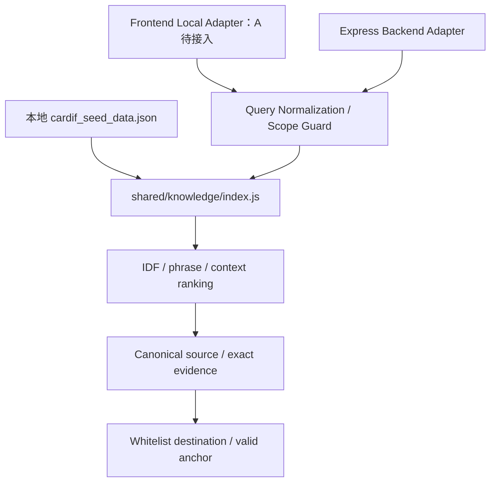

# Developer B Phase 4C Report

日期：2026-10-13。開始基準 `74e4ee8`；驗收前已 fast-forward 同步 A 的 `64edcc4`、`75fb6d7`（知識查詢不建案件、瀏覽器資料最小留存）。本次只做共享本地 Knowledge／Navigation，**沒有開始 Phase 5 或部署**。

## 範圍與協作

開始前讀取 AGENTS、SPEC、README、Backend／Frontend 實作、資料與測試。工作目錄原有 `docs/phase-2a-report.md` 修改保留，不提交。沒有修改 A 的 UI／動畫／embed、seed、既有 Journey／Intent／文件 schema 或 AGENTS。

修改 shared 前已在 [PR #2](https://github.com/NAVI-Hackathon/NAVI/pull/2#issuecomment-6148830552) 通知；使用者以 Developer A（Sh）身分明確同意共用 ESM、新增模組與院所擷取小修，後續協作由本人轉達。Git 依先前明確授權使用 main 與英文 commit，不 force push。

## 1. 修改檔案

- `shared/knowledge/index.js`：Snapshot index、排名、highlights、來源／摘錄／導航驗證、原文 context。
- `shared/knowledge/vocabulary.js`：正規化、同義詞、資格護欄、範圍／類型 cues、集中 ranking 參數。
- `shared/cardif.js`：保留原有服務欄位，補讀申請時間、生效時間、線上辦理與客服專線；沒有改 seed。
- `shared/hospitalization.js`：院所 prefix 裁切小修，不放寬 partner matching。
- `knowledge/cardif.js`：改為共用引擎 compatibility exports，移除第二份 public index／排名。
- Backend `services/knowledgeService.js`、`routes/journeys.js`：共用 Adapter／相容回應／新增公共搜尋 endpoint。
- `apps/api/eval/knowledge/{cases.jsonl,runner.js,cli.js}`：獨立 dataset、實際 metrics、離線指令。
- `apps/api/test/{sharedKnowledge.test.js,sharedKnowledgeBaseline.test.js}`：新增來源、安全、HTTP、Browser Adapter、原 Frontend assertions。
- root／api `package.json`：`eval:knowledge`；README／architecture／本報告。

## 2. 盤點差異與整合選擇

| 項目 | 原 Frontend | 原 Backend | Phase 4C |
| --- | --- | --- | --- |
| Index | 全部服務、表單、FAQ、文件、一般規則 | 另一份 index，部分服務欄位省略 | 共用 Snapshot index，保留相同 ID，補服務欄位與前置確認題 |
| Normalization | 中文 bigram、filler、少量同義詞、否定住院 | NFKC／簡化 bigram，硬編碼分流優先 | 沿用 Frontend、增加集中中英文 aliases／錯字 |
| Ranking | IDF、標題／keyword／body、phrase、coverage、type cues | 類別 Regex 分流 + 簡化計分 | 保留成熟排名，加 service／medical context、穩定排序 |
| Scope | 主要中文投保／資格拒答 | 不同的資格 regex | 共用中英文護欄、換行正規化、Unsupported guard |
| Sources | ID 與 destination.source | sourceId／sourceUrl／date，另一套 metadata | canonical metadata、既有 ID／destination 與新 source 欄位 |
| Snippets | relevant detail lines | 較粗的 whole-content answer | 保留 highlights；回答只用 Snapshot 完整原文行 |
| 結果 | status/results/related/highlights/hotline | answer/sources/found/isMock | Engine 保留 UI 介面；Backend 保留舊欄位並附公共搜尋結果 |

Frontend 檔案尚未切換，因此**現行 Frontend 與 Backend 仍非所有 Query 完全一致**。例如 Legacy 英文與門診順位能力不同；這是交付 A 的遷移步驟，不宣稱 UI 已完成切換。原 Frontend 的 5 組知識測試（包含 30 次 query 驗收）另以不改期待值的版本驗收 shared 引擎；原測試仍保留。

## 3. Shared Knowledge Architecture



純 ESM，沿用 import JSON with attributes；shared 不用 fs、DOM、window、API Key 或網路。不新增套件。已用 Vite 打包，再以無 process／Buffer／require 等 Node globals 的隔離 VM 執行全部 86 個 Query 的預期狀態與 Top-1 驗收；這是 Browser bundle 相容性驗證，非完整瀏覽器視覺測試。

## 4. Normalization / Ranking

NFKC、臺→台、大小寫、標點／空白、中文 filler 與重疊 bigram 沿用既有方式。英文只做明確 aliases，例如 outpatient surgery、policy loan、beneficiary form、address change、password locked；小範圍錯字如通訊地止／地阯、锁。

資料正文保持原樣；重寫只用於檢索。IDF 降低常見字權重，標題／keyword／body、exact/partial phrase、coverage、distinctive token、type/context boost 集中在 vocabulary。最多 3 個 results、3 個 related。穩定 tie break 使用 ID。沒有 Embeddings、Vector DB 或語言模型。

沒有泛用中文斷詞或任意拼字糾正；aliases 是保守、可評估的有限集合。

## 5. 門診／住院與安全邊界

- 門診／否定住院的流程問題優先 `claim-doc:1`，排除住院文件清單。明確查詢醫起通本身仍可引用其公開服務說明；不憑住院與否新增來源未支持的管道限制，搜尋本身不開 Journey。
- 明確住院流程優先 `claim-doc:2`，避免混入其他疾病文件清單。
- 「沒有住院證明」不等同「沒有住院」。
- 能不能賠、是否符合保障、金額／給付日數核定、投保建議等返回 out_of_scope、空結果與客服專線。
- 門診開刀只引用 Snapshot 已有的醫療門診文件；不生成手術特定保障或額外文件。
- 公共搜尋完全沒有 JourneyRepository side effect；原住院知識查詢防護保留，A 最新 main 也已避免建立案件。

Readiness、Workflow、Documents、最終服務資格均未改。

## 6. 來源、原文與 Provenance

公共 entries 附 sourceId/title/sourceUrl/retrievedAt/content/navigationDestination；sourceType=public_site_snapshot。日期直接來自 seed.meta.crawled，未編造新日期。ID 保留 service:<id>、form:<id>、faq:<n>、claim-doc:<n>、claim-rule:<n>。

`verifyKnowledgeSource` 對 canonical ID、title、section、URL、日期與目的地；`verifyEvidenceSnippet` 檢查完整原文行確實屬於對應 record；外來 source、假日期、跨來源拼接和虛構條款被拒絕。content 只有 Snapshot 字串；UI 的分類、節標題、導引摘要不是官網原文，不能拿來作 quote。

Canonical entries 遞迴 freeze，避免呼叫端變更來源而污染下一次搜尋。Answer context 依 highlights 優先、最多 1800 字，只收完整來源行，不截斷事實。Snapshot 為團隊手動整理，未在本次重新查核即時官網；「原文」指本地 Snapshot 摘錄，不宣稱每條人工摘要都是官網逐字全文。

Provenance 分離：公共知識 public_site_snapshot／isMock=false；歷史 FAQ prototype_guide/prototype_faq／isMock=true；合成文件 synthetic_demo 的概念仍用既有 source=demo／isMock=true 表達，不增加破壞性 enum。合成文件與 Legacy FAQ 不進公共 index。

## 7. Navigation Security

每筆 destination 先通過既有 NavigationTargetSchema 的 source/path/anchor 白名單，再以 sourceId 對應 canonical kind、label、route、anchor、來源日期／網址。所有 index 目的地已比對實際 mock-site page 與渲染 anchor。

不接受 javascript:、data:、protocol-relative、未知 route／anchor／外部網站或替換來源。Source URL 只作來源連結，導航仍是模擬站 internal path。現有 postMessage 精確 origin + expected window + Zod 驗證保留並回歸，不修改 embed。

## 8. Hospital Mention 小修

原本 prefix regex 會把「不存在」中的「在」當成敘述分隔。現在只在後面仍有完整院所標記時移除前綴。`我在台中榮總不存在分院住院五天` 擷取完整「台中榮總不存在分院」，仍為非合作；「榮總」仍不猜院所，埔里等既有明確分院不受影響。

## 9. API Compatibility

- 新增 `GET /api/knowledge/search?query=...`：純公共搜尋，回原 UI shape，永不 fallback Legacy／呼叫 Provider。
- `GET /api/knowledge?query=...`：公共結果保留 answer/sources/found/isMock，另附 status/results/related/highlights/hotline。歷史 prototype 回應保留原欄位，公共搜尋不出現它。
- `POST /api/knowledge/answer`：舊 Provider／Demo／extractive validation／fallback 能力保留。使用共用 context；只有另行明確啟用 Live 才涉及模型生成，本次沒有執行。要零 AI 直接用上述 GET。
- 其餘 Intent、Journey、multipart、review、handoff endpoints 與 shared schema 不變。

保留一個舊班機安全 disclaimer 的相容查詢，供原有 120 題回歸使用；只回 prototype 的「依條款與審核確認」，不是資格判定，也不進公共服務搜尋。未刪 Legacy 資料或測試。

## 10. Evaluation Dataset / Metrics

`apps/api/eval/knowledge/cases.jsonl`：96 題，含 19 個原 Frontend 正向案例、41 個新增檢索問題、11 個 Unsupported、15 個資格／投保拒答、10 個導航攻擊。為保守統計 newCases=51（41 新檢索 + 10 新導航）；重用的 guard baseline 不當成新增案例灌數。

每題有人工期待的 Top-1／Top-3 relevant ID、status 或導航拒絕。Runner 實際計算 metrics，不手填。Top-3 Recall 本批以每題一個主要 relevant ID 為標註，不代表全面多標籤 recall。

| 指標 | 實際結果 |
| --- | --- |
| Top-1 Accuracy | 60/60，100% |
| Top-3 Recall | 60/60，100% |
| Unsupported Query Rejection | 11/11，100% |
| Out-of-scope Detection | 15/15，100% |
| Navigation Accuracy（含攻擊拒絕） | 70/70，100% |
| Invalid Source Rate | 0/155，0% |
| Invalid Route Rate | 0/155，0% |
| Latency p50 / p95 | 0.216 / 0.417 ms |

延遲採獨立 eval:knowledge 執行，86 個 query 樣本的 warm shared retrieval，不含 HTTP／模組初始化；會隨機器與同時程序變動。96/96 通過。這是 curated local retrieval 的通過率，不是 Gemini Accuracy、醫療診斷或理賠資格準確率。

## 11. Regression / Acceptance

- `npm test`：同步 A `75fb6d7` 後 Frontend 36 + Backend 127 = **163/163**。B 增加 17 個 test groups，不移除／弱化既有測試。
- `eval:ai:local`：120/120；`eval:hospitalization`：76/76；住院 Golden Path 35→70→90→100 保留。
- `eval:knowledge`：96/96；全部零外部 fetch 嘗試。
- `lint` 與兩站 `build:all` 通過。
- 新增 86 個 query 的 shared Browser Adapter ↔ Backend Adapter parity，以及真實 loopback Express endpoint 測試：ID、URL、日期、目的地、原文、拒答狀態一致；空／過長輸入安全拒絕。
- Legacy Frontend 代表案例的 common source metadata 與 Top-1 相容；其他醫療結果有意縮窄，不能宣稱尚未切換的 Frontend 與新 Engine 全部結果相同。
- 雙站 HTTP smoke 通過：8 個模擬站路由、資產、Vite API proxy 與 API 隔離。Vite 共用模組的 86 題隔離 VM 驗證亦通過；沒有新增視覺／動畫 QA。

## 12. Frontend Migration Guide（A 接入）

不需要重做 UI。A 可將 `apps/web/src/domain/knowledge.js` 縮為下列相容匯出：

```js
export { knowledgeEntries, searchKnowledge, getKnowledgeEntry, typeLabels }
  from '../../../../shared/knowledge/index.js';
```

維持 AnswerCard／AssistantPanel 的 entry.summary/details/destination 與 KnowledgeAnswers 的 status/results/related/highlights/hotline。每筆結果另有 sourceId/sourceUrl/retrievedAt/content/navigationDestination。分類與摘要是 UI 文案；「原文」只使用 content／highlights 並以 verifyEvidenceSnippet 驗證。

若改用 Backend，GET /api/knowledge/search 即有同 shape；既有 `/knowledge` 保留 answer contract，但含歷史 prototype 相容層，公共 UI 應優先新 endpoint 或 shared search。不要再新增前端 alias／ranking 的第二套規則。只有 user 明確要進行的支援服務才開 Journey，知識回答不開 Journey。

A 的前端 import 切換尚未實作，本次不改 apps/web。切換後再跑原 Frontend tests、navigation tests 與完整桌面／手機 Demo。

## 13. Zero-Cost Confirmation

Gemini Requests=0，Paid API Calls=0，新增 Dependencies=0。沒有執行 Live 指令、官方站爬蟲、Search Grounding、Embeddings、Vector DB 或部署。ALLOW_PAID_AI=false、CI block、Free Tier attestation、Live Request Budget、Demo／Live Provider 全部保留。一般測試及評估預載 networkGuard，只允許 loopback 與注入 transport；Public HTTP test 即使注入 live-mode stub 也驗證 Provider call=0。

## 14. Known Limitations / Technical Debt

- A 尚須切換 Frontend import；不能把共享能力宣稱為所有 UI 已完成遷移。
- Snapshot 時效與人工整理品質未即時查核，沒有查到資料即 not_found；不補任何條款。
- FAQ／文件 ID 依 Snapshot 順序，重排 seed 時需同步 anchors 與契約驗收。
- Ranking 是有限 aliases＋bigram；長尾問法、同時門診與住院的複合問題可能需要澄清。單一臨床清單不代表疾病或手術保障適用。
- 96 題不是全面語意泛化測試。沒有做自由生成事實驗證；既有 AI answer 仍限制原文選取。
- 原 InMemory／Auth／上傳安全限制沿用 Phase 4B，本階段未新增資料庫、正式核賠或真人工單。

## 15. 下一階段建議（未開始）

A 先完成 import 切換與兩站實際導航／手機 Demo。下一輪依真實未命中但不含個資的題目補 alias／來源標註與澄清案例；Snapshot 更新仍由既有授權管道處理。若考慮 Live，只在另行授權與零成本條件確認後規劃合成資料驗收。**本次停止於 Phase 4C，不自行進 Phase 5。**
