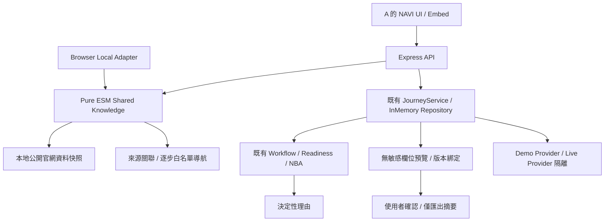

# NAVI Competition Readiness & Differentiation

本階段僅擴充 Developer B 的 Backend、共用契約及驗證工具。A 已同意此範圍；UI／動畫、舊 Journey schema、既有 endpoints 及 postMessage v1 均保留。

## 既有能力與本次差異

| 能力 | 原有實作 | 本次補齊 |
| --- | --- | --- |
| 知識 | 同一份公開官網 Snapshot、本地排名、來源 ID、逐行摘錄驗證 | 可直接消費的 evidence API、日期檢查、快照年齡提示、明確區分本地驗證與即時官網查核 |
| 導覽 | 單步白名單目標，origin + source window 驗證 | 由既有來源關聯建立多步計畫，整份計畫可驗證，禁止跳步／調序／換來源 |
| Journey | Server-owned deterministic Workflow、35→70→90→100、手動資訊不計文件分數 | 每一計分項的 earned、原因碼、缺件、矛盾與原有 Next Best Action |
| 交接 | 舊 deterministic summary／可選 AI 潤飾 | 省略敏感欄位的預覽、十分鐘有效、案件版本綁定、使用者確認後取得摘要，沒有真正傳送 |
| 評估 | 三組本地題組、離線網路護欄 | 可重現 Evidence Pack、合成 HTTP 流程、建置頁面錨點、真實延遲統計與商業假說界線 |

同步基準：`97d08747cb5e683117e746092ee24d7c9334e615`。A 已加入正式模式手動資訊 UI，以及固定頁首導覽修正，本次不重做。原始 main checkout 的 `docs/phase-2a-report.md` 未提交修改保留於原處；開發使用獨立 worktree。

## 架構



AI interprets. The system decides. 本次新增功能不呼叫 Provider；Demo 文件仍是明確標示的合成分析，沒有提升為真實 AI 辨識。所有資料準備度不代表理賠核准、保障適用、送件或核付。

## A 可直接串接的契約

Schema：`shared/competition.js`。Pure ESM 入口：`shared/knowledge/navigationPlan.js`、`shared/knowledge/evidence.js`。只用現有 zod 與資料快照，不依賴 Node API、DOM 或 API Key，可由 Vite 打包。

### 1. 導航計畫

`POST /api/navigation/plans`

請求二選一，不能混用，不能附 URL／path：

```json
{"query":"住院理賠需要哪些文件"}
```

```json
{"sourceId":"claim-doc:2"}
```

回應 `{status, plan, hotline}`；status 沿用 answered／not_found／out_of_scope。拒答或查無資料時 plan=null，不建立 Journey。

plan：`{version:1, rootSourceId, steps, execution:"user_guided", disclaimer}`。

每一步：`{id, order, sourceId, action, instruction, source, destination, evidence}`。

- action：VIEW_INFORMATION／VIEW_FORM／OPEN_SERVICE，均僅為頁面導覽。
- 根來源及 relatedIds 完全來自既有知識索引。表單可以接續相關服務；服務先說明、再看相關表單、再返回服務入口，最多四步。
- 住院示例：claim-doc:2 → form:claim_1.1.1 → service:claim_by_mail。這是查閱公開資料的導覽順序，不保證管道適用，不送出申請。
- 每一步綁定同一筆 canonical Source ID、URL、擷取日、白名單 route、已登錄 anchor 及原文快照行。
- `verifyNavigationPlan(plan)` 重建同一來源的 canonical plan 後比對；單筆合法目標不代表任意組合或調序也合法。
- A 按使用者操作逐步前進，使用現有 `navi:navigate` 傳該步 destination；必須保留既有 expectedSource／allowedOrigins 驗證。不要把整份新 plan 塞進舊 postMessage，亦不要自動登入、確認條款、填寫或送件。
- 本機 Adapter 可直接 `planNavigation({query})`，API Adapter 呼叫新 endpoint，兩者共用同一函式。

本次修正「受益人變更」被名詞條目搶先的排名：明確變更意圖優先服務；表單／下載仍優先表單；名詞定義仍由 glossary 回應。四個中英文案例加入正式檢索題組。

### 2. 可驗證知識證據

`GET /api/knowledge/evidence?query=<encodeURIComponent(question)>`

回應：`{status, results, hotline, disclaimer}`。每筆為：

```js
{
  source: { id, sourceId, title, section, type, isMock, url, sourceUrl, retrievedAt, navigationDestination },
  excerpts: [/* 與本地快照逐行相同的文字，最多三行 */],
  snapshot: { status: 'snapshot_available' /* 或 review_recommended */, ageDays },
  verificationScope: 'local_snapshot',
  liveWebsiteChecked: false
}
```

來源、摘錄、日期與導航皆須通過現有 canonical index；日期無效或未來日期不回傳。超過 90 日建議更新是維護提醒，不是保險規則失效判斷。此門檻集中於 `SNAPSHOT_REVIEW_AFTER_DAYS`。

重要：這驗證的是本地 Snapshot 的字串與 metadata，不證明當天官網仍相同，也不把歷史人工整理內容宣稱為重新查核過的官網逐字原文。UI 建議使用「資料快照摘錄」，保留擷取日期及來源連結；若要標示「已即時查核官網」，需另有人工／爬蟲審核證據。

### 3. Journey 理由

`GET /api/journeys/:id/explanation`

回應 `JourneyExplanationSchema`：journeyId、journeyUpdatedAt、readiness、currentStage、supported、criteria、missingRequirementIds、consistencyIssues、nextAction、sources、disclaimer。

criteria 保留既有 Requirement 欄位，僅增加 earned／reasonCode／reason：

| reasonCode | UI 意義 |
| --- | --- |
| VERIFIED | 已通過現有資料檢查並取得該項分數 |
| MANUAL_UNVERIFIED | 只有手動資訊，不計文件分數 |
| DOCUMENT_NEEDS_REVIEW | 欄位、信心或交叉比對需要確認；同時查看 consistencyIssues |
| DOCUMENT_MISSING | 尚缺已驗證文件 |
| INFORMATION_MISSING | 尚缺符合既有規則的資訊 |
| CONFIRMATION_REQUIRED | 必要文件齊備後，仍需使用者確認 |
| OPTIONAL | 條件性項目，非每案必備、不計分 |

earned 僅投影既有 requirement.status／weight；不另建第二套規則。readiness、stage、NBA 直接取 server-owned Journey。35→70→90→100、刪除文件撤分、Human Review 與手動輸入限制維持。

### 4. 安全交接

`POST /api/journeys/:id/handoff/preview`，body=`{}`，回 201：

```js
{ previewId, journeyId, expiresAt, status: 'awaiting_confirmation', summary }
```

A 顯示 **這份 summary**，讓使用者確認，再送：

`POST /api/journeys/:id/handoff/confirm`

```json
{"previewId":"<預覽 UUID>","confirmed":true}
```

回 200：`{previewId,journeyId,confirmedAt,status:"confirmed",delivery:"not_sent",summary}`。

- summary 是 allowlist 投影：服務類型、已備／缺少項目、靜態矛盾標籤、來源、Demo／Live 出處。完全省略原始文字、病患／戶名、醫院值、住院日期、帳號尾碼、檔名及臨床欄位。
- 不把來源的公開日期當病患資料遮蔽；source metadata 維持可驗證。
- 預覽十分鐘有效、同案只保留最新一份；綁定完整 Journey revision SHA-256，不僅依賴時間戳。
- 案件更新後確認會回 409 HANDOFF_PREVIEW_STALE；過期、跨案件、已使用、已替換回 409 HANDOFF_PREVIEW_INVALID，需重新預覽。
- false／缺少確認／額外傳 summary 回 400 INVALID_INPUT；容量達上限回 503 HANDOFF_CAPACITY_REACHED。
- 確認不改 Readiness、不代表理賠 Review、不呼叫真人服務、不建立工單、不傳訊息或寄信。A 應寫「取得交接摘要」，不能宣稱「已轉交專員」。
- 舊 `/handoff-summary` 保留相容性。新的使用者交接互動請使用 preview→confirm，不能用舊 endpoint 冒充已確認。

錯誤維持 `{success:false,error:{code,message,retryable}}`。無登入的 prototype 中 journeyId／previewId 是能力識別碼，不可視為正式存取控制；不適合真實敏感資料。

## 可重現驗證與 Demo Evidence

本次實測結果見 [Evidence 摘要](competition-evidence-results.md) 與 [機器可讀結果](evidence/competition-6dc74c6.json)。

```bash
npm ci
npm run evidence:demo
```

需 Node >=22.12；執行 test、lint、build:all、三組本地 evaluation、合成 HTTP E2E，輸出 `artifacts/demo-evidence/<時間>/report.json`、每項 log、log SHA-256、Commit、工作樹狀態及題組 SHA-256。任何指令失敗即 complete=false，不會繼續宣稱全通過。

單獨重跑 E2E 前先 `npm run build:all`，再 `npm run test:competition:e2e`。它會驗證真實 API、來源、摘錄，以及 Next 建置 HTML 真的存在的導航錨點；連續執行五次住院 Golden Path、確認摘要及移除文件。**這是 Backend HTTP E2E＋建置頁面驗證，不是瀏覽器點擊／視覺驗收。** A 接入新 UI 後仍須驗收逐步導覽與確認互動。

Evidence 的正確率由維護中的本地題組計算，不是 Gemini 準確率。API p50／p95 含 loopback HTTP 與 JSON 讀取，不含真人點擊、上傳網路時間或真實 AI；整條合成流程耗時不等於使用者完成時間。

### 商業效益界線

已量測：檢索題組通過率、來源／導航驗證率、API 延遲、Golden Path 準備度與撤回、測試流程步數。

尚未量測，僅為假說：降低找入口時間、降低缺件返工、降低客服轉接量。不能對評審宣稱已節省特定百分比或金額。

後續可做真人交叉試驗：同一批合成任務分別用模擬官網自行尋找與 NAVI，順序交錯，記錄成功率、完成時間、中位數、缺件數與主觀負擔。例：時間差比例=(原流程時間−NAVI時間)/原流程時間。使用者數、信賴區間及是否只是小樣本均須揭露；目前未執行此試驗。

## 公開環境與 HTTPS 評估

2026-10-20 UTC 唯讀檢查新 VPS `207.148.113.119`：Nginx／navi-api active；公開 80、8080，API 127.0.0.1:18172；沒有 443 TLS listener，未找到 certbot。本次沒有變更 VPS 設定、切換 release 或接觸舊 VPS。

免費 IP HTTPS 現已可行，並非一定需要網域。依 [Let's Encrypt 官方公告](https://letsencrypt.org/2026/01/15/6day-and-ip-general-availability) IP 憑證有效期 160 小時；[Certbot 官方整合說明](https://letsencrypt.org/2026/03/11/shorter-certs-certbot) 建議支援 IP webroot 的 Certbot >=5.4、shortlived profile、定期自動更新及 deploy-hook 重新載入 Nginx。

部署建議：先驗證 ACME staging、用 webroot 保持服務在線，確認自動續期及失敗告警後，規劃兩個互信 HTTPS origins、重新 build Embed origins、更新 CORS／postMessage allowlist，完整驗收換頁／高亮再切換。不能取消 origin 檢查，也不能混用 HTTPS 主頁與 HTTP iframe。

本階段僅評估，尚未配置 HTTPS。現行 HTTP 只能使用合成資料；即使配置 TLS，正式敏感資料仍需要授權、儲存期限、安全審查等額外工作。

## 限制與下一步

- 無新付費依賴、無 Live Gemini、無真實文件；知識是既有本地快照，日期不等於今日正確性保證。
- 導覽只驗證靜態路由／錨點及資料關聯；登入後辦理、個別資格與真正申請不在範圍。
- 預覽與 Journey 都在單程序記憶體，重新啟動即失效；未加入正式身分權限或稽核留存。
- A 接入新 API 後完成 Desktop／Mobile Browser E2E，再安排 HTTPS、完整真人可用性試驗與經授權的新版本部署。
