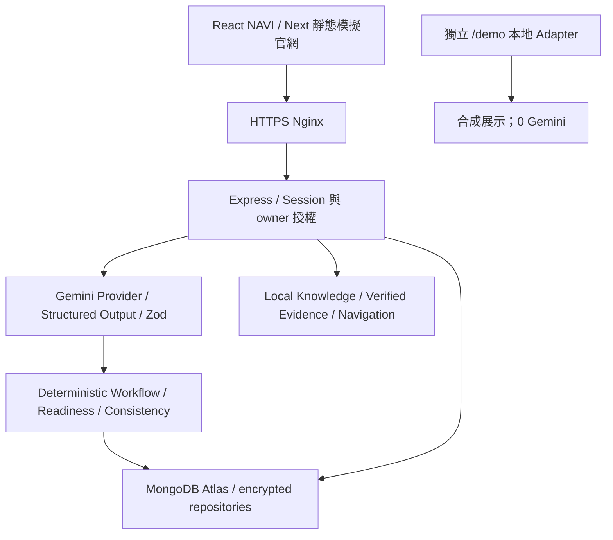

# NAVI Final Technical Evidence

核對時間（UTC）：2026-10-28T15:34:36.825400+00:00。這是脫敏技術證據索引；原始 API 紀錄、憑證、影片與簡報不提交 Git。技術文件不能取代原始報告；以下分母、方法和版本不可混算。

## 正式部署與架構

已核對 Production/main：`d123b2cf4be185c7d7d8966456fcb93d2de10739`，Release `/opt/navi-hackathon/releases/d123b2cf4be1-1793189924`；[主站](https://navitw.com)、[NAVI](https://app.navitw.com)、[Mongo Readiness](https://app.navitw.com/api/ready)。文件 PR 自身 SHA 不是已部署的新應用版本。

AI interprets，system decides。Navigation 只由可信 Source IDs／白名單產生；住院 35→70→90→100 由規則計算。100% 只表示 NAVI 初步資料準備，不是保障資格、核賠或送件。

## MongoDB：已完成與未完成

官方 Node Driver，Atlas TLS＋連線池；users/auth_sessions/journeys/tasks/task_batches/handoff_drafts/conversations/audit 等持久化，ownerId 後端授權。Payload AES-256-GCM，AAD 綁定 namespace／ID／owner／TTL／revision；密碼 scrypt、Cookie Secure/HttpOnly/SameSite、交易與 CAS、TTL／owner／Journey 關聯索引。原始文件不預設永久保存。備份是加密資料＋HMAC 簽章，金鑰分開保管；線上刪除不立即抹除備份，約 7 天輪替。詳見 [A3 契約](a3-persistence-contract.md)。

- 真實 Atlas 私有驗收：16／16，執行 2026-10-28T12:08:33.275Z、Git `f4bfc12b35562f3a456a5a2c3891accb0c2bf1c1`。API／DB 真實，AI 明確使用隔離 Demo，因此不是 Gemini 品質證據。含 restart、A/B owner 拒絕、Task Recovery、草稿、文件刪除撤分、真實 DB 出站阻斷 503、37 筆簽章備份還原到獨立空 DB，之後清除測試資料。
- 公開 HTTPS 帳號生命週期：8／8，執行 2026-10-28T12:20:20.526Z、Git `d123b2cf4be185c7d7d8966456fcb93d2de10739`，包含真正重啟後 Cookie／登入恢復、匯出不含密碼、刪除提交。另瀏覽器登入／重新整理 3／3。原有真實帳號數與 Journey 數不能由合成測試推論。
- SMTP 未設定：公開註冊保持關閉，僅受控合成帳號及匿名合成 Session；真實郵件驗證與密碼重設寄送尚未驗收。
- **應用仍使用 atlasAdmin**。本輪使用者明確要求不處理憑證調整，未建立 readWrite 使用者、未切換／撤銷舊憑證，也未修改 IP Access List。不能將最小權限列為完成。[Atlas 角色說明](https://www.mongodb.com/docs/atlas/security-add-mongodb-users/)與應用 ownerId 防護是不同層。

## Gemini：策略、真實結果與待實測

線上 `gemini-3.1-flash-lite`，AI_MODE=live、ALLOW_PAID_AI=false；模型目錄與已核准 capability/tier 交集才可路由。實作具備 Queue／有限 fallback／circuit／持久化 budget；**目前正式配置只有既有核准模型、attempt=1，不能宣稱線上已自動切換成功**。429 專案配額不以換 Key／模型規避。Schema／Backend validation 不因換模型省略，失敗不回 Demo。

本輪實測配置為每日20／Session6／併發1／10秒／1次。AI Studio 可見 Free tier 與 3.1 Flash Lite 15 RPM／250K TPM／500 RPD；Models metadata GET 200。兩者不證明生成一定成功或固定剩餘量。最初 Preflight 為未授權；之後使用者核准最多6次，實際第一題遇Google503即停。**新版僅有1個API錯誤樣本；文件仍待實測**，詳見本文件末的實際結果。計畫、GT、Dataset SHA 與原始報告 hash 見 [Live Preflight](final-live-preflight.md)。

歷史真實證據：Git `e2a6100ecd88cebf4a714fe93368c194bf0cd22c`，完成時間 2026-10-26T20:49:48.999394+08:00，同模型的 3 次合成 API 生成有成功事件；Intent 2215ms、診斷 PDF 3070ms、存摺 2172ms。原始報告 SHA `e661af540e6826cb950c030d71c16028502bd8cb1c825f8b5fdb6d0ee61fd267` 已重新比對。這只證明舊版本當次生成，**沒有 v2 Ground Truth 對照，不計新版正確率、欄位 F1 或泛化能力**。其他歷史成功／失敗與 provenance 缺口保留在 [Live Matrix](live-evidence-matrix.md)，不挑掉失敗樣本。

## 回歸／Browser 證據

同一 d123b2cf 發布的原始報告：Frontend 86／86、Backend 365／365；本地 Layout39／39、Browser15／15、Android模擬15／15；線上 Demo9通過＋6項需本地 Mock API 的測試明確跳過；線上375/390/430及縮短高度鍵盤模擬5／5。它們是規則、Mock或 UX 證據，不是 Google 模型或實體 iPhone。A3 45／45 持久化回歸另列，不與 Backend365 重複加總。

Knowledge `kb-1404d058190e380c66eedee1`；Legacy120、住院76、Knowledge134 是三個不同本地資料集。來源原文／retrievedAt／導航對應已核對，retrievedAt 不是發布日期。地址2個不同目標、契約變更表單1步。Public asset 11份／1,018,412 bytes 與 Release 相符，私有欄位命中0；6個部署私有路徑未提供原始內容。

## 本輪回滾演練與故障：不能隱藏

實際執行了69ec669與d123b2cf間的切換。第一輪驗證遇到測試工具重用舊連線；重驗時短時間啟停觸發既有 StartLimitBurst=3/300秒，造成 API 暫時503。只對 NAVI 執行 reset-failed 後回復 d123b2cf，沒有放寬或停用啟動保護；外部 health/ready 與本機 symlink 已重新驗證。**不能把這次完整回滾演練列為零故障通過**。後續演練需安排維護窗口與啟停間隔，避免在正式站反覆重啟。

原始失敗：`artifacts/final-release-check-stale-socket.log`、`artifacts/final-release-check.json.log`；恢復：`artifacts/final-recovery.log`。原有 Atlas 驗收與本輪「已恢復可用」分開陳述，未覆寫失敗報告。

## 安全與產品邊界

目前只接受合成資料，不公開接受真實醫療／銀行文件；Free Tier 的第三方處理限制、SMTP、企業登入／法遵不因 HTTPS 或加密而自動完成。沒有保險公司客服／送件 API，交接是確認後的未送出草稿／下載，不能捏造工單或核賠。iPhone Safari 實機與真人 UX 成效由 A 的實際紀錄另驗；本文件不生成使用者效益百分比。

## 原始結果索引（SHA-256）

以下均為本機忽略的脫敏證據；未公開原始憑證或簡報。時間與 Git 以各報告 envelope 為準；沒有 envelope 的 log 對應上述發布紀錄與固定執行命令。

| 報告 | UTC 時間（envelope；無則為檔案保存 mtime） | SHA-256 |
|---|---|---|
| `artifacts/atlas-acceptance-report.json` | 2026-10-28T12:08:33.275Z | `25a16adfa7f294e2e2a97abe134973526f52e507b933954b4beae9a2df35f5ad` |
| `artifacts/atlas-production-account-report.json` | 2026-10-28T12:20:20.526Z | `7669cb31f70fb3c22a6878bdb5fc5771917f6016aa1e826cab161aee25c2812f` |
| `artifacts/atlas-final-main-tests.log` | 2026-10-28T12:21:07.397143+00:00（mtime） | `e5ecec16fbce450073493b407341855694c7c5dbde8e9acaa5beae7c37923677` |
| `artifacts/atlas-final-production-browser.log` | 2026-10-28T12:23:50.761900+00:00（mtime） | `528b467e98d21208dd091e26350aaf9930b79ca39812b5f2a648ef68511adf3c` |
| `artifacts/atlas-final-production-layout.log` | 2026-10-28T12:23:06.354552+00:00（mtime） | `641fc412552e78317366a356fe67ed0489f9cd00df1cc129769bdd62f6206ec1` |
| `artifacts/atlas-production-http.json` | 2026-10-28T12:21:08.861Z | `dff7ac64d9cc68051afa53f6e638f55da3494733c619bec6843d60fff75dcbd1` |
| `artifacts/final-v2-dry.json.log` | 2026-10-28T15:27:37.024975+00:00（mtime） | `50338bd0d8c9622b6abaa072f551d786c43ff6e43218308696356cc7fcaf0b7b` |
| `artifacts/holdout/mock-1793201257304.json` | 2026-10-28T15:27:37.301Z | `7a7c7a8555565170c9b77ec6d1e316dd7462faf6e7d67ad72f7b4214007af5fe` |
| `artifacts/final-holdout-tests.log` | 2026-10-28T15:27:37.749395+00:00（mtime） | `ac50fd56a1b6f82acbd9997279fb75e338e1821d7f3c040685fa91cb28f8ef20` |
| `artifacts/final-production-quota.jsonl` | 2026-10-28T15:27:42.963933+00:00（mtime） | `f8ac1d557711e978ff9c827a20b89b6899e0ca2222bd909d4badcd2453376a90` |
| `artifacts/final-model-metadata.json` | 2026-10-28T15:30:44.755Z | `5728735c763da33495edb9e89d22db7b700de07e3c7c579e4904a6f773ab6789` |
| `artifacts/final-release-check-stale-socket.log` | 2026-10-28T15:30:31.404086+00:00（mtime） | `1665f08ab30b9b1cb073d3c5922f95f0fabe0269fbd63dc231e2c67578d35e1c` |
| `artifacts/final-release-check.json.log` | 2026-10-28T15:31:43.510671+00:00（mtime） | `c7c217e85c436cb6510327acbeaf89e0ef2b18919b935361f173c8146ae3a5d4` |
| `artifacts/final-recovery.log` | 2026-10-28T15:32:37.262305+00:00（mtime） | `a7feb50e46be50ad7bb35b661a3f4505a299dd1cba5c817e75a39da6acf599d4` |

恢復後再次核對：`artifacts/final-restored-production.log`，SHA `49b775b7cb0e138854b378fba7e9141edd8ea1db07bee3d104abfca460c15266`；保存 UTC 2026-10-28T15:35:03.695491+00:00。API/Nginx active，Result=success，當日生成0，記憶體/OOM數字以此原始檔為準。

## 已核准後的實際執行結果（首次失敗即停）

使用者在本對話明確核准最多6次、禁止重試。執行程式與 Provider 取自正式 d123b2cf4be185c7d7d8966456fcb93d2de10739；凍結 Dataset SHA 未改，AI Studio 免費方案在執行前再次核對。直接呼叫部署版本的 Gemini Provider／Services，不是 Browser E2E；使用既有 MongoDB 持久化日用量與受控 Session 計數。沒有在公開站植入 Demo 測試旅程。

- 時間：2026-10-28T15:39:09.994Z；實際模型 `gemini-3.1-flash-lite`。
- I21：真實 generateContent POST **1次**，Google HTTP **503 UNAVAILABLE**，訊息為模型需求量高；NAVI `AI_PROVIDER_ERROR`。這證明收到 Google 的錯誤回應，不證明模型完成推論，也不能歸因於 Free Tier 排隊。
- 模型 HTTP 往返 3241.93ms；完整既有 Service 呼叫 4167.24ms（包含模型目錄／規則開銷）。Token Usage 未提供，記錄 null。
- 已立即停止：I22、I23、I25、I29、D21 均未執行；全 v2 未執行27／28。核准上限6，實際生成請求1，剩餘5不自動續用。
- 重試0、模型切換0、Demo fallback0、付費呼叫0。獨立 metadata GET在擷取內為1，不計入生成次數；Preflight先前另有1次單模型 metadata GET。
- 用原 Scorer：Intent完整任務集合 **0／1**（API錯誤列失敗，不是語意誤判）；API錯誤率1／1、逾時率0／1；p50/p95均4167.24ms，僅 n=1，不代表常態延遲。文件樣本0，Precision／Recall／F1 **null，待實測**。不能宣稱完整 v2、六題子集或整個產品的準確率。
- 執行後 Pacific-day用量1／20、專用Session1／6；沒有提高、重設或規避額度。此輪授權已依失敗停止規則結束，不再發出模型生成。

| 原始紀錄（忽略於Git） | SHA-256 |
|---|---|
| `artifacts/final-live-evaluation/authorization.json` | `a6e7647245060f4e1b11c06fc490143609de4b03a989d53dbb3b14c18f500f74` |
| `artifacts/final-live-evaluation/I21-raw.json` | `db48703e3e8c0435c7f28a92ee2d7762207f6f7ffbe3ad9154e629c15ab7bd42` |
| `artifacts/final-live-evaluation/observations.json` | `293ed009c050a27174f93c87a98cfdff36adf0fb72d466b5affbf0a4a9770f09` |
| `artifacts/final-live-evaluation/transport.json` | `173af560c43e376398a497f58fa657622432ab42d3012b3f76e6da4f83680ce0` |
| `artifacts/final-live-evaluation/report.json` | `7a2b291303abe37256a3506c14b483905721236ae1fe6e6c3c2be45db03679ce` |
| `artifacts/holdout/score-1793201986555.json` | `cbba99de712a03bba4300a622943dd80423a85d8c1eaad908782a469fe1acefd` |

未挑成功案例，也未修改 Ground Truth；錯誤樣本已保留。原始檔為合成案例與清理過的 Provider 回應，不包含 API Key、Cookie、操作員 Token 或個人文件。
