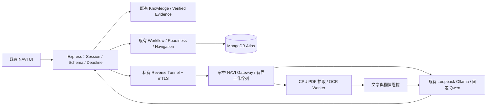

# Ollama 完全替代：現況、差距及分階段驗收

日期：2026-10-30。狀態：**設計提案，尚未實作／部署／切換 Provider**。

本輪依使用者最新決策，以 Express、MongoDB Atlas 及現有 NAVI 引擎為基礎規劃；SPEC／AGENTS 中早期的 OpenAI、Turso、Cloudflare 技術描述不代表目前實作。本 PR 不修改這些協作文件、不安裝相依套件、不修改 shared 或 UI。後續契約另開 PR 與 A 對齊。

配套文件：[Provider 與工具契約](ollama-provider-contract.md)、[Tunnel Staging 設計](ollama-tunnel-staging-plan.md)。這些是技術設計文件，不包含簡報、帳戶資料、環境密鑰或原始私人紀錄。

## 1. 版本與既有缺陷：先完成 Phase 0

本輪從 `origin/main` 建立 `docs/ollama-migration-design`，未覆蓋其他工作線。

| 項目 | 實際盤點結果 |
|---|---|
| main／本輪回歸基準 | `6bc1a90d49a50344d4fde89b873bcbf622faeb38` |
| Production | 最後已有證據為 `d123b2cf4be185c7d7d8966456fcb93d2de10739`；本輪沒有登入 VPS，**不是今天重新驗證的線上 SHA** |
| A PR #33 | OPEN，`f780fdf577836b246389515a9d4ca443c33e2bda`；A3 UI 整合，不能當成 Renderer 故障已修復 |
| PR #35 | OPEN，`fc0a329ec8700f908cd6c188db9fe3b9fa10278d`；Graceful Shutdown、Mongo close、獨立健康探測、部署鎖／冷卻及有界復原。沿用其工作，不能假設已合併上線 |
| PR #36 | DRAFT OPEN，`358ba2721d35d6935900cbc9eb8fe3cb14c33682`；澄清、Grounding、失敗語意、刪除資料還原防護等。其額外測試不算入 main 基準 |
| GitHub CI | 上述三個 PR 當次查詢均沒有 Check 紀錄；`MERGEABLE` 不等於已通過驗收 |

本機原工作線維持原狀；另一工作目錄的 `docs/phase-2a-report.md` 未提交修改未動。此次沒有合併 #33／#35／#36。

### 本輪真正執行的基準

2026-10-30 UTC，本機 Node 22.23.3、隔離的本機 MongoDB、阻擋外部 Transport：

| 檢查 | 結果 | 證據範圍 |
|---|---|---|
| `npm test` | Frontend **86/86**、Backend **365/365** | 規則／Mock／本機資料庫測試，不是 Ollama 或 Gemini 品質 |
| E13 故障注入 Browser | **0/3，三項失敗** | 真正 Chromium，API 為 Mock Transport；`AI_PROVIDER_ERROR`、`AI_TIMEOUT`、`AI_DAILY_LIMIT_REACHED` 的合法 retrieval 回應皆造成 Renderer crash |
| `npm run lint` | 通過 | 現有 Script 僅檢查 mock-site ESLint，非整個 Repository 的型別檢查 |
| `npm run build` | 通過 | 公開投影檢查、Vite build、Web 公開資產掃描；8 個檔案、0 findings。不是雙站 Build 或 Production 部署驗收 |

E13：開啟 `/embed`，輸入「我要改通訊地址」，注入 `ConversationReplySchema` 可接受的 `understanding: null`、`mode: retrieval`、有效 Evidence 及上述 errorCode。`apps/web/src/components/landing/Landing.jsx:103` 直接讀取 `message.followUp.showAnswers`，拋出 `Cannot read properties of undefined (reading 'showAnswers')`。A 需修正 nullable understanding／follow-up 的 Renderer，並對這三種回應增加 Browser regression；B 不在此 PR 覆寫 A 的 UI。錯誤狀態可用是 Staging 前置條件，不能用模型升級掩蓋。

本機原始檔不推送公開 GitHub；可用 SHA-256 核對：

| 本機相對路徑 | SHA-256 |
|---|---|
| `artifacts/ollama-design-baseline/main-tests.log` | `785d2d2eab7321bebdd11134edddf546e1a42312c53f4498cce50c88f1efce14` |
| `artifacts/ollama-design-baseline/e13-main.log` | `22727fd6b8cf7fdef79bb9aca2a10f2159f8c72db922a19a47915c382aad9ce6` |
| `artifacts/ollama-design-baseline/main-e13.spec.js` | `b9d5f1fae02c83fe07dbdc2923f4145531bfd71341f873ccd71d973729989353` |

## 2. 可重用能力與必要修改

| 現有位置 | 保留 | 必須補的差距 |
|---|---|---|
| `apps/api/src/ai/provider.js` | `live/demo/unavailable` 分離、禁止假辨識 | `live` 目前固定建立 Gemini；新增 `AI_BACKEND`，最終只允許 Ollama，連不上不改走 Gemini |
| `apps/api/src/services/gemini.service.js` | 六個方法的輸入／領域輸出介面、Prompt 與 Zod | Google payload、`inlineData`、API Key、正規化名稱不能直接改 URL 充當 Ollama |
| `apps/api/src/config/env.js`、`config/product.js`、`ai/costGuard.js` | Production fail-closed、安全設定集中管理 | 模型 regex、Free Tier、金鑰與政策綁 Google；分離模式、Backend、模型與資源限制 |
| `ai/modelRouter.js`、`resourceQueue.js`、`services/providerRequest.js` | FIFO、背壓、中止、整體 Deadline、錯誤分類 | 不沿用 Google Models API／跨模型備援；消除重複 Queue／重試／計數，診斷改 requestId 而非 operation 共用 Map |
| `middleware/productSession.js`、`testSession.js` | owner／Session、同意、上傳權限與限流 | Google 專屬同意版本／文案、以 `getModelRouter()` 判斷計數的隱式規則須改；不能套用舊同意 |
| `intent.service.js`、`shared/intelligence.js`、Web `services/apiJourney.js` | 舊 response／歷史 Journey | `meta.source` 及本地 Journey ref 只容許 `gemini/demo_fallback`；新增 `ollama` 需 A 先更新讀取者，不能把本地推論標記為 Gemini |
| `services/documentService.js`、`documentValidationService.js` | MIME／Magic、10 MiB、SHA、qpdf／影像解碼、日期計算、Consistency | 尚無文字層抽取／OCR／欄位證據綁定，不能把 PDF／圖片原始 bytes 交給文字 Qwen 當視覺能力 |
| Mongo Store／Repository、Journey／Task Service | 加密欄位、ownerId、版本、交易、Idempotency、歷程恢復 | 只補 Backend／Pipeline provenance；不建第二個資料庫或記憶體 Workflow |
| `shared/knowledge/*`、Knowledge／Navigation Service | 本地搜尋、Source ID、原文驗證、版本、目的地白名單 | Agent 呼叫同一套服務；失敗轉 retrieval-only，不生成無來源規定／網址 |
| Handoff Service | 遮蔽、Preview／Confirm、已知事實、`not_sent` | 本地摘要仍只能選取／整理已知事實，失敗用既有 deterministic 摘要 |
| v2 Holdout、Browser／Layout／安全檢查 | 凍結答案、歷史失敗、樣本分母 | 另外記錄 Ollama／OCR／工具品質與 GPU，舊 Mock／Gemini 成績不代表新模型 |

未完成企業能力（例如公開敏感文件的適用處理依據、SMTP、Atlas 最小權限）不因改成本地推論而自動完成。本輪不動憑證、角色、IP 白名單、保存政策或 Knowledge 審核結果。

## 3. 目標路徑

Ollama 是最終唯一生成 Backend；Demo 留在原有獨立 Adapter。模型斷線時，Knowledge 可以回傳可驗證的原文、聯絡／導航入口與澄清，`mode: retrieval`；不得標成模型成功，不取得文件驗證分數，不用 Google 或 Fixture 頂替。

## 4. 完全本地文件 Pipeline

### 4.1 選型與位置

優先選 **Poppler + Tesseract（`chi_tra+eng`）CPU Worker，放家中 Ubuntu**。VPS 1 GB 只做既有上傳／權限檢查和串流轉送，不能在 VPS 開大型 OCR 常駐服務，也不假設 Qwen 有視覺能力。[Qwen 模型卡](https://huggingface.co/Qwen/Qwen3-4B-Instruct-2507)將此模型列為 Text Generation；工具和 Structured Output 仍須在指定 Ollama／模型實測。

先比較 Tesseract `fast/best` 語料，固定版本與模型檔 SHA；[Tesseract 語言資料](https://tesseract-ocr.github.io/tessdoc/Data-Files.html)與[影像品質指引](https://tesseract-ocr.github.io/tessdoc/ImproveQuality.html)是設定依據，不是 NAVI 正確率證據。[PaddleOCR](https://www.paddleocr.ai/main/en/version3.x/algorithm/PP-OCRv5/PP-OCRv5.html)只在同一凍結題組顯示 Tesseract 確有缺口時評估，不先加 Python／GPU 複雜依賴。安裝套件須另依 AGENTS 溝通；本輪沒有安裝。

### 4.2 執行步驟與信任邊界

1. Express 對實際 bytes 計算 SHA、限制 MIME／副檔名／Magic／大小，驗證 owner、Session、用途同意、請求與文件權限。合成 SHA 僅識別範例，不替代檔案驗證或分析。
2. Gateway 再驗檔案，無權限 Worker 依 qpdf、解碼器做結構檢查，拒絕加密、主動內容、附件、損壞及資源炸彈。保留現有最多 20 頁的上限；上限不代表每份 20 頁文件都能在 Deadline 內完成。
3. 按頁處理：有文字層 PDF 使用 Poppler 文字／位置抽取；掃描頁／圖片本地 Render／OCR。混合 PDF 逐頁決定，不以整份 PDF 有幾個字就跳過其他頁。限制頁面像素、CPU、RAM、子程序、輸出長度及佇列時間；先完成一頁再處理下一頁。
4. 保留 `pageId / label / boundingBox / extractionMethod`；對醫療／銀行關鍵欄位做文字層與可見影像對照，避免隱藏文字層欺騙。不清楚的欄位為 null，品質不足就 `needs_review`。
5. Qwen 只接收有頁碼與標籤的文字、Schema 及必要上下文。輸出文件類型及可見欄位，不輸出 verified、readiness、資格、送件狀態或計算住院天數。文件中的指令一律是不可信資料，文件分析方法沒有工具權限。
6. Express 驗 Zod，再把每個關鍵值綁回 Worker 的來源位置。**字串出現並不足夠**，還須符合欄位標籤、同一列／位置與允許的正規化；不得拿另一個人的姓名或一串日期填錯欄位。任意模型產生的 pageId 不算證據。
7. Backend 沿用日期計算、跨文件姓名／院所／日期／帳戶衝突、重複 SHA 及原有 Requirement 機制。需重新驗證、低品質、矛盾或未知文件不加分；刪除仍按原規則撤回。verified 只代表欄位／一致性檢查，文件真偽與保險資格仍未驗證。

初版 OCR 不承諾手寫、複雜表格、印章、低解析度及旋轉嚴重文件的可靠性。每類都要有獨立測試；不支持時說明原因並轉人工確認，不填預設臺中榮總或範例帳戶。

### 4.3 資料生命週期

- 原始檔、完整 OCR 和模型輸入僅在該次有界工作期間存在；獨立 0600 暫存／受限 tmpfs，成功、失敗、中止皆終止子程序並清除，另有孤兒 Job 清理。tmpfs、RAM 不代表安全抹除，Swap、Core Dump、除錯與主機備份也須納入部署檢查。
- Express／Gateway／Worker／Ollama 不記錄原文、完整姓名、帳號、提示詞或影像 Base64；只留 requestId、Pipeline 版本、狀態、耗時、受控雜湊和必要 metadata。檔案雜湊也可能用於關聯，依既有資料保留／刪除政策管理。
- 公開回應不含完整帳號／OCR 原文；既有 last4、遮蔽與 Mongo 加密不移除。欄位證據若需保存，只留必要的頁碼／方法／品質摘要，不能把敏感片段塞進 Audit Log。
- 本地推論減少雲端 AI 傳送，但仍跨 VPS／家中主機，MongoDB Atlas 仍是第三方儲存。公開真實醫療／銀行文件維持限制，直到用途、同意、存取、保存、備份與刪除全部通過驗收。

## 5. RTX 2060 SUPER 與 Adrift 共用策略

使用者提供的主機、Ollama 版本及 GPU 資訊是規劃輸入，未由本輪連線核實。[指定 Ollama tag](https://ollama.com/library/qwen3:4b-instruct-2507-q4_K_M)存在；模型檔約 2.5 GB **不等於實際 VRAM**，還有 KV Cache、Context、Workspace 與其他模型。

| 項目 | 初版策略與限制 |
|---|---|
| 隔離範圍 | NAVI Gateway／OCR／SSH 帳號及服務獨立，不另開第二個 Ollama 載入同模型冒充 GPU 隔離 |
| GPU 排程 | NAVI 初期同時一筆生成，有限 Queue；需與 Adrift 協調共用 Admission／Lease，或在核准的閒置時段驗收。只看 GPU Util／`/api/ps` 無法消除 Adrift 同時送請求的競爭 |
| 不可自動修改 | Adrift 服務、全域 `OLLAMA_NUM_PARALLEL`／模型載入設定、預設模型、keep_alive、卸載／重啟共享 Ollama、GPU Clock／Power |
| Context | 候選初值 4096 Context／1024 輸出；須以實際 tokenizer 計算 System、Schema、工具、歷史及輸出保留量。未選定可靠 tokenizer 前不得靠字數宣稱不截斷 |
| CPU OCR | 初期一筆工作，採專屬 cgroup 限 CPU／RAM／子程序；限額依 12 GB 主機與 Adrift Baseline 實測，不把候選值當可用餘裕 |
| 中止／Timeout | 上游中止傳遞至 Ollama及子程序；HTTP 斷線不等於 GPU 已停。執行狀態不明時保留資源占用判斷／開 Circuit，不重送同筆、不殺共享服務 |
| 冷啟動 | 記錄模型載入、首輪、暖機；不擅自預熱或卸載 Adrift 模型。Ollama duration 為奈秒需轉換，非串流初版不填虛構 TTFT |
| 故障 | Tunnel／Gateway／模型斷線、GPU OOM、Queue 滿分別分類；只停 NAVI 工作，回 retrieval／明確文件未分析，不切外部 Provider |

Adrift 單獨、NAVI 單獨、兩者小量並行各量測 GPU VRAM、CPU、RAM、Swap、冷／暖啟動、Queue／OCR／推論／整體 p50/p95、失敗及取消後 GPU 回復。共同排程尚未取得協作前，不能承諾「不影響 Adrift」。候選驗收門檻為 Adrift p95 劣化不超過 10%、無 OOM／服務重啟，**只是待同意的 Gate，不是已測結果**。

## 6. 品質驗收與證據

保留凍結 v2 **28 題（16 Intent／12 Document）**，Dataset SHA `b4e8215133a3c7b9d3157af152c41eabee3c206d5cef249d95b56740b6d09920`。這是開發者題組，已用於回歸，不能稱為盲測。另請非開發者在執行前提供／凍結獨立案例；沒有資料就標未取得。

| 指標 | 計算與證據要求 |
|---|---|
| Intent／否定／澄清 | 正確／實際執行題數、各類 Precision／Recall、Confusion Matrix；Timeout／錯誤獨立保留，不能刪分母 |
| 多任務 | 該題全部預期任務都保留、沒有多造任務才算完整；意圖修正不沿用錯誤 Journey 分數 |
| 工具 | 選取正確工具率、參數正確率分列；JSON 合法不等於工具正確；跨 owner／非法 URL／過期版本必須拒絕 |
| Grounding／Navigation | Source、原文、服務適用、版本全正確才通過；錯誤導航與無依據答案率分列 |
| 文件 | 類型、欄位 Precision／Recall／F1、空缺拒絕、無關文件錯誤通過、矛盾處理；同時列 OCR 純文字與完整 Pipeline 成績 |
| Agent Task Success | 真實 Browser 任務完整結束／題數，需包含適當澄清／拒絕；不能以模型單輪分數或 300 次 GPU 加權分數代替 |
| 效能／穩定性 | p50/p95、Cold/Warm、Queue wait、OCR、Inference、整體耗時、錯誤／Timeout／取消率、資源與 Adrift 基準 |

每筆保留 Case ID、執行模式（Mock／實際 Ollama／Browser）、Ground Truth、實際輸出與失敗、Git／Dataset／KB／OCR Pipeline 版本、模型完整 digest、Ollama 版本、時間、報告雜湊及實際生成輪數。敏感原文不能進公開報告。既有 GPU 300 次報告本輪未收到／重跑，沒有可推導的 Agent 成功率。

初步建議 Gate：安全負例（資料外洩、跨 owner、假來源／網址、readiness override、無關文件 verified、Google／付費呼叫）為 0；Intent 90%、多任務完整率 90%、Tool Arguments 95%、文件 Field F1 90% 為改善目標，須同時報分母／類別。這些均未達成實測主張，不能拿小樣本當正式產品品質。暖機文字 p95 15 秒、文件／Agent 60 秒可先作可行性目標，無法達成時縮小支持範圍或調整經同意的 SLO，不能偷偷加 Timeout。

歷史 Google I21 的 503、1/6 次執行、0 重試／切換／Demo／付費及 Document F1=null 原樣保存，不能改寫成 Qwen 成績；歷史成功也不算新 Backend 驗收。

## 7. 分階段 PR 與停止條件

| 階段／建議 PR | 實際範圍 | 必須通過才能往下 |
|---|---|---|
| D：本設計 PR | 三份設計與 main 基準 | A／主機擁有者審閱，不變更 Runtime |
| R：既有可靠性整合 | Review／重基底 #35／#36，A 修 Renderer | E13 三種失敗狀態不 crash；既有 Journey／Grounding／還原防護／Graceful Shutdown 回歸。不可自動合併本來開啟的 PR |
| T：Tunnel／Gateway Staging | 專用帳號、mTLS Gateway、SSH 與假 Upstream | 正負權限、公開不可連、斷線復原、Adrift Baseline；先在隔離環境，兩台主機變更另獲授權 |
| O：Provider／契約 | OllamaProvider、設定、正規化、來源／同意／計數 | Mock HTTP：schema、abort、deadline、queue、0 Gemini；A 先支援來源新值與舊歷史讀取 |
| F：本地文件 | Poppler／OCR Worker、欄位證據、清理 | 中文／英文／日期／表格／模糊／多頁／Injection／衝突／無關／取消；不足不加分 |
| A：唯讀 Agent | 有界工具 registry，沿用現有服務 | owner、Schema、Source、Navigation、總 Deadline、無副作用、歷史與 task correction 回歸 |
| E：獨立 Staging | 核准的真實本地模型／OCR／Browser及 Adrift 並行驗收 | 固定版本／分母／原始失敗紀錄；GPU 負載與外部零生成驗證 |
| C：正式切換 PR | 使用者確認後才部署，先備份／相容性檢查 | reader-first、Rollback rehearsal、無 Google 生成、Production Marker／Mongo ready／UI／Demo／資源正常 |

每個 Runtime PR 在最新 main 上跑實際存在的 `npm test`、`test:layout`、`test:e2e`、`test:product`、`lint`、`typecheck:mock`、`build:all`、`eval:ai:local`、`eval:hospitalization`、`eval:knowledge`、`test:navigation`、`security:public` 及新增的局部測試；Google Live runner 不執行。Mock 的 Ollama 傳輸測試與真實模型品質分開。設計 PR 不宣稱已執行這整套 Runtime 發布驗收。

### 切換與回滾原則

最終 runtime factory 的 live 分支只可建立 Ollama；Google 程式若保留作離線歷史測試，不得被正式 Router 取得。未知／未設定 Backend 不偷偷選 Gemini。金鑰撤銷或移除另行授權，不在此 PR 處理。

先發布能讀舊／新來源的 A 客戶端，再發布新 Writer；保留原始歷史 Gemini provenance，不能整批改成 Ollama。Mongo 資料、Session、Knowledge Release 和 owner 不重置。

回滾保留上一個 Release 與設定，但**不能因回滾把 live Gemini 重新啟用**；退回時使用明確 `unavailable`＋可信資料檢索／獨立 Demo，並驗證該 Release 與 Mongo Schema、設定及新來源的相容性。未通過兩主機通道、品質、隱私與共同 GPU 驗收前，不提出正式切換成功主張。

## 8. 本輪未執行事項

Gemini 生成 0、Ollama 生成 0、付費呼叫 0。未 SSH 任何 VPS／家中主機、未建立 Tunnel／帳號、未變更 AI_MODE、未安裝 OCR、未修改 UI/shared/runtime、未合併既有 PR、未部署。正式主機狀態、所述硬體／版本、真實 OCR 品質、GPU 取消／並行行為與最新 Production SHA 均留待獲准的 Staging／唯讀盤點驗證。
