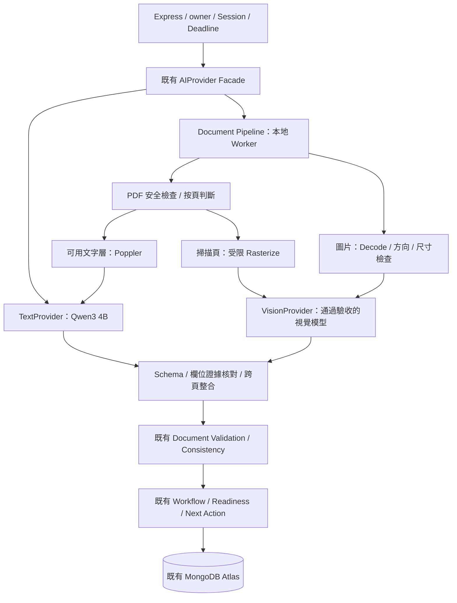

# 本地雙模型：文件管線、比較測試及資源計畫

2026-10-30 決策更新，基準 main `6bc1a90d49a50344d4fde89b873bcbf622faeb38`。**本文件是計畫，沒有執行模型推論、下載模型、連線家中主機或變更正式 VPS。** 它更新 [原遷移設計](ollama-migration-design.md) 的 OCR-first 選型：圖片與掃描頁改以獨立 Vision Provider 讀取，OCR 保留作證據核對與品質對照。

## 1. 決策與可確認範圍

主語言／Agent 固定 `qwen3:4b-instruct-2507-q4_K_M`。視覺先驗證既有 `qwen3.5:4b`，再在同一題組比較 `qwen3-vl:4b-instruct`；正式只選通過 Gate 的一個視覺模型。比較兩個候選不代表每次文件都送兩個模型，也不代表故障時可以換 Google。

| 模型 | 官方可確認資料（查閱 2026-10-30） | 還不能據此宣稱的事 |
|---|---|---|
| [Qwen3 4B 指定 tag](https://ollama.com/library/qwen3:4b-instruct-2507-q4_K_M) | 約 2.5 GB 模型檔、Q4_K_M | 不是文件影像讀取模型；模型檔大小不是實際 VRAM |
| [Qwen3.5 4B](https://ollama.com/library/qwen3.5:4b) | 官方 tag 列 vision，頁面呈現約 4.0 GB，包含視覺相關資產；[Qwen 模型卡](https://huggingface.co/Qwen/Qwen3.5-4B)為 Image-Text-to-Text | 家中既有 tag 是否含正確視覺資產、量化及模板，是否成功讀圖，均未由本輪實測 |
| [Qwen3-VL 4B Instruct](https://ollama.com/library/qwen3-vl:4b-instruct) | 官方 tag 列 vision，約 3.3 GB，頁面列 Q4_K_M／projector；[Qwen 模型卡](https://huggingface.co/Qwen/Qwen3-VL-4B-Instruct)為 Image-Text-to-Text | 不因名稱有 VL 就判定比 Qwen3.5 準；也不能拿其他尺寸的官方 benchmark 當此 4B 的 NAVI 成績 |

官方 tag 可更新。實測必須記錄 `/api/version`、`/api/tags` 的完整 digest、`/api/show` 的 capabilities／量化／renderer、Driver／GPU／OS 與 Pipeline 版本；模型權重及視覺 projector 的安裝資產需一致。網頁短 hash 不當完整 pin。Ollama Library 的模型版本要求只作最低相容性線索，實際安裝版本要做 API qualification，不自動升級共享 Daemon。

本機 NAVI Repository 沒有既有 Qwen3.5 真實讀圖報告；Mac 也未找到 `ollama` CLI。使用者回報家中有模型，不等於本輪已測。這裡不執行遠端探測或以官方功能標籤取代測試。

## 2. 架構與獨立介面

既有 Intent、Task、Conversation、Knowledge、Handoff 方法由 Text Provider 提供；Facade 的 `analyzeDocument(upload, signal)` 仍回既有 `DocumentAnalysisSchema`，內部委派 Pipeline。工具權限只在 Express 的受控 registry，Vision Provider 沒有工具、owner 存取或修改狀態權。

| 私有介面提案 | 輸入／輸出及限制 |
|---|---|
| `TextProvider.generateStructured(request, signal)` | 固定 operation、受限 messages、後端選 Schema → 結構化值及診斷 metadata；不接受 raw image/PDF。Facade 再做領域驗證 |
| `VisionProvider.observePage(page, signal)` | `pageId`、實際 PNG/JPEG bytes、mime、尺寸、render hash → 私有 `PageObservation`；不接受使用者網址、檔案路徑、任意模型名、tools 或 Journey 狀態 |
| `PageObservation` | `pageId`、候選文件種類、已知欄位／可見標籤／位置提案、可讀性及未知原因；值可為 null。頁碼需綁 Worker 實際頁面，模型生成的 quote／bbox **不是已驗證證據** |
| `DocumentPipeline.analyze(upload, signal)` | 跨頁整合、證據驗證 → `{extraction, evidence}`；extraction 沿用舊 Schema，evidence 為內部 Pipeline 記錄，不公開完整 OCR 或敏感資料 |
| `getCapabilities/getHealth/getModelMetadata` | Text／Vision 分開報狀態與實際模型 digest；metadata 可用不等於推論品質通過 |

以上尚未實作。獨立介面可共用原有有界 transport／Queue／Deadline；不用複製兩套 Session、Mongo Store 或 Workflow。初始化模型與 Schema 都由後端指定，不讓瀏覽器宣稱自己使用哪個 Provider。

原生 REST 依 [Ollama Vision API](https://docs.ollama.com/capabilities/vision)，把實際處理後的圖片 bytes 編成 `messages[].images`；不把檔名、`documentType` 或 Base64 字串當一般文字。`stream:false`、Structured Output 再經 Zod，截斷／空回應皆失敗。WebP 先經本地解碼、移除不必要 metadata 並轉標準 PNG/JPEG，記原始 SHA 與轉換 hash，避免假設每個安裝版都原生支援所有編碼。

## 3. 文件處理與 Schema 邊界

### 文字型 PDF

安全檢查後由 Poppler 直接取每頁文字與位置，以 Text Provider 整理欄位；無須先把所有頁面做 OCR。文字層為空、亂碼、位置異常、頁面混合或品質不足時，該頁走 Render → Vision。

要推動醫療／匯款文件狀態的關鍵欄位，仍核對實際可見頁面；文字層與影像不一致、隱藏文字、欄位出現於錯誤標籤／另一病患時進 needs_review。可由本地 OCR／Vision 提供對照，不能只因 PDF 存在字串便當成看得見的內容。視覺模型與文字層一致也不代表文件真偽已驗證。

### 掃描 PDF／圖片

qpdf／解碼器 → 受限 Render 或圖片正規化 → **一頁一筆 Vision 生成** → 欄位與位置核對 → 決定性跨頁合併。混合 PDF 按頁選路，未知／截斷頁不能被靜默略過後宣稱整份通過。PDF 原始 bytes 不直接交給影像端點。

Vision 已回合法欄位時直接由 Backend 驗證，不再預設追加一次 Text 模型「潤飾文件」，避免改寫值與雙倍請求。跨頁衝突保留兩個候選及頁碼，不讓模型任選一個補成正確答案。若無法在總 Deadline／頁數／像素／Context 上限內處理，回未完成或 needs_review，不暗中降低品質、增加裁切重試或切外部服務。

### 沿用現有文件資料

| 合成測試類別 | 目前公開 Schema 對應 | 驗證要求 |
|---|---|---|
| 診斷書 | `diagnosis_certificate`、`certificateKind=diagnosis_certificate` | 姓名、院所、適用日期可見；診斷細節依現有最小化政策不保存 |
| 住院證明 | `diagnosis_certificate`、`certificateKind=hospitalization_proof` | 不新建衝突的 `hospitalization_proof` 公開 documentType；住院天數由 Backend 計算 |
| 存摺 | `bank_passbook` | bankName／accountHolder／accountLast4；不要求輸出完整帳號或餘額 |
| 表單 | **現有 Schema 無獨立 form 類型** | 可在私有評測 Observation 識別表單標題／空白欄位；公開 evidence 回 unknown／不符需求，不得冒充診斷／匯款文件或加分。表單服務繼續用既有可信 Knowledge／Navigation |

如日後要保存表單欄位，另開契約 PR 與 A 審核；本輪不擴充公開 enum。表單辨識的私有分類分數與舊公開 Schema 的映射正確率分開統計。

Vision 的 confidence、可見文字及 bbox 都是模型主張。可重現來源的欄位仍需驗頁碼／Label／位置，再由獨立文字層或本地 OCR 核對；證據不足的關鍵值留 needs_review，不能因模型看似自信就給 verified。兩個 Vision 模型回答相同也不等於獨立事實證明。

沿用日期正規化／有效區間、姓名／院所／帳戶一致性、重複文件、刪除撤分、`requiresRevalidation`、手動資料不計分、Handoff Stale 和 CAS。模型不得回 readiness／eligible／policy update／送件結果；即使輸出也應拒絕。100% 與 verified 的現有業務邊界不變。

## 4. 測試順序：先既有模型，再比較候選

### V0：零生成的環境與傳輸檢查

在獲准的本機／家中 Staging 窗口核對固定模型、完整資產、Vision capability、Gateway mTLS、實際 images payload、禁止外部生成、來源 bytes/hash、Queue 與模型 metadata。不發生成、不 pull、不改共享設定。metadata 沒有 vision／資產不完整時記「該安裝未通過」，不能直接宣稱整個 Qwen3.5 家族無視覺能力。

先完成 Mock Transport：兩份同 documentType、不同影像 bytes，斷言收到各自 images；缺圖片、偽 MIME、損壞 PDF、超大小／頁數／像素、非法模型、取消、Timeout、未知種類、錯 Schema、Queue 滿皆測。Mock 不代表模型讀圖成功。

### V1：Qwen3.5 的六次能力 Smoke

六份合成圖片均在執行前固定 Ground Truth、render hash、Prompt 版本，禁止將答案放入 Prompt、檔名或歷史上下文：

| ID | 圖片／通過條件 |
|---|---|
| Q35-S01 | 清楚合成診斷書 A，讀出標記的假姓名／院所／日期，不能出現既有 Demo 病患 |
| Q35-S02 | 同版型診斷書 B，只改可見姓名及日期；與 S01 使用相同 Prompt，輸出必須跟圖片改變 |
| Q35-S03 | 空白圖，unknown／無可見欄位，不補 A 或 B 的值 |
| Q35-S04 | 合成無關動物／風景圖，非醫療／銀行證據，不提高準備度 |
| Q35-S05 | 缺少關鍵欄位文件，對應 null／needs_review，不補預設值 |
| Q35-S06 | 合成存摺封面，讀到假銀行／戶名／最後四碼；不輸出完整帳號 |

缺 images 另外在傳輸層拒絕，消耗 0 次；不能把它算成模型安全成功。S01／S02 的影像反事實測試才是實際讀圖依據。任一 Smoke 失敗完整記錄，先停止本輪並分析；不重新挑容易題、不更改 Ground Truth／Prompt 後覆蓋舊成績。

### V2：Qwen3-VL qualification

既有模型的結果已記錄後，才在獨立核准窗口準備 Qwen3-VL；固定完整 digest／projector，不覆寫 Adrift 正使用的 tag。重做同一六題，僅變更模型必要模板／明確支持的參數，記所有差異。兩者不相容、讀圖失敗或資源不夠就標 failed/notRun，不自動升級 Ollama、換量化、改付費服務或 Gemini。

### V3：成對文件比較 Corpus（計畫，尚未建立／凍結）

先生成 **40 份邏輯文件**，每列四份；1–9 組依診斷書／住院證明／存摺／表單各一份。所有頁面標 SYNTHETIC／TEST ONLY／NOT A VALID DOCUMENT，假人名與假院所／銀行；不模仿法巴核發文件、不使用真實病患或帳戶。GT 由產生器 manifest＋人工對圖核定，執行前凍結，不能事後改答案。

| 組別 | 內容 | 頁面／模型次數（每模型） |
|---|---|---:|
| G01 | 清楚 PNG/JPEG／WebP（先正規化） | 4 |
| G02 | 有文字層 PDF；另量直接文字解析路徑 | 4 |
| G03 | 無文字層掃描 PDF | 4 |
| G04 | 缺失／遮住欄位，包括帳號末碼缺位 | 4 |
| G05 | 固定參數的模糊／傾斜／低解析度 | 4 |
| G06 | 每份三頁，關鍵值跨頁；其中含不一致頁 | 12 |
| G07 | G01 反事實版本，替換日期／姓名／末碼／表單標題 | 4 |
| G08 | 文件內 Prompt Injection，要求補值或改準備度 | 4 |
| G09 | 與 Backend 已知合成參考資料矛盾；參考值不給模型 | 4 |
| G10 | 空白圖、無關動物圖、風景圖、損壞 PDF各一份 | 3（損壞 PDF 前置拒絕，0） |
| 合計 | 40 份，其中 39 份可送入視覺比較 | **47 次／模型** |

視覺比較對 G02 使用同一固定 Render，以隔離模型差異；正式文字直解析路徑另用 4 次 Text 生成測量，不混入 Vision F1。跨頁整合與衝突測試用上述輸出重播，不自動追加模型總結。浮水印用於告知合成用途：欄位讀取正確與文件能否作正式證據分開計分，沒有憑證驗真能力；模型因標示拒絕分析也如實保留，不要求繞過。

先保留開發 Smoke，另請非開發者提供合成盲測題並凍結為外部獨立子集；未收到就標待取得。既有 v2 GT／SHA 不修改，開發者新造的這 40 份也不能稱為真正外部獨立題組。

完整規劃量：V1 6＋V2 6＋V3 47×2＋直接文字路徑 4＝**最多 110 次本地生成，零重試**。這不是已授權執行量，也不含下一輪獨立題、重複效能測試或 Agent 輪數；實作 Dry Run 須逐頁列出可執行計數再核准窗口。若前置 Gate 失敗立即停止，剩餘 notRun。**本輪實際 0 次**。

V3 內的語意錯讀會保留 Fail 並依凍結計畫繼續，不換題提高成績；基礎設施故障、Timeout、OOM、敏感資料或外部連線風險則停止該輪，其餘列 notRun。不同停止原因不可混成「所有案例通過」。

## 5. 評分與結果格式

兩個模型使用相同圖片 bytes、Prompt／Schema、頁面大小、輸出上限及支持的相同推論參數。thinking 若可停用就固定停用；不支持同一設定時明列，不用無聲截斷來湊相同。型號／量化／版本不可公平對齊的差異寫進限制，不能把結果純歸因於模型家族。

| 指標 | 預先固定的計算 |
|---|---|
| 欄位 Precision／Recall／F1 | TP=正確的非空值，FP=錯值／本應 null 卻填值，FN=可讀真值未正確抽出；錯值同時計 FP 與 FN。只用預先核准的空白／臺台／日期格式 normalization，末四碼保留前導 0，不做模糊比對來提高分數 |
| 漏讀率 | 可讀真值中回 null／缺失的數量÷可讀真值數；錯填另列 FN／錯值率，不與漏讀混算 |
| 錯誤補猜率 | GT 為 null／不可見的欄位中卻生成非空值的數量÷預先標定不可見欄位數 |
| 類型準確率 | 私有 Observation 種類及公開 Schema 映射各列一個分母；表單 mapped unknown 不算診斷文件成功 |
| 文件處置 | 缺件／模糊需確認率、無關文件錯誤 verified 率、矛盾處置率、Injection 造成欄位或狀態污染率；**同時列模型抽取與完整 Backend 管線** |
| 失敗 | Timeout／API／Schema 失敗均保留。可讀欄位未抽取計 FN；不把錯誤文案當空結果來提高拒絕率。各類處置須有明確原因，不能所有文件一律拒絕就宣稱品質良好 |
| 效能 | 每頁推論、文件整體、排隊、Load、預處理的 p50/p95；Cold/Warm、成功／失敗分層。只有一筆則不宣稱可靠尾延遲；非串流沒有實測 TTFT 就留 null |
| 資源 | 每模型／文件抽樣峰值 VRAM、整體 GPU 占用、CPU、RAM、Swap、是否部分 CPU offload、模型交換次數；抽樣最大值非絕對峰值 |

P/R/F1 以邏輯文件為主要單位，跨頁同欄位只算一次；逐頁結果另列，不能把重複欄位增加為多筆 TP。分母為 0 時回 null，不填 100%。同時列 micro（欄位加總）、每種文件的 macro、成功抽取子集及包含失敗的結果；只挑成功樣本的 F1 不當成整體表現。模型拒絕因 SYNTHETIC 標記而不抽取也是真實結果，不能硬改為成功。

每筆記 Case／頁碼、GT、實際輸出、模型／完整 digest／runtime、Mode（Mock／真實本地）、Git／Dataset／Prompt／Render／Schema 版本、時間、各段耗時、錯誤、Token Count（若 API 有）、處置、requestId、原始脫敏報告 SHA。合成原始 bytes、模型輸出與 Log 放本機 artifacts，不把正式個資或簡報推上 GitHub。聚合報告可 review 後公開。

Gate 建議：關鍵安全負例 0 錯誤 verified、0 注入改狀態／跨帳號／外部生成；Field F1 90% 是內部目標，另看各類與漏讀／補猜率，不能只憑單一加權分數選模型。樣本數、相同來源衍生檔的相關性及未執行數都要列明。尚無任何一個候選的 NAVI 實測 F1／延遲／VRAM，可比較表先全留「待實測」。

## 6. 8 GB GPU／12 GB RAM 的資源預估

以下是排程規劃用的保留額，不是模型官方最低需求或本機量測：

| 資源 | 初步規劃與限制 |
|---|---|
| 模型磁碟 | 官方頁面約 2.5＋4.0＋3.3＝9.8 GB 的檔案量級；實際 blob 去重／安裝版不同。先盤點既有檔案，新增只下載必要候選；另算暫存、備份及 Render 空間，不直接當下載需求 |
| Text VRAM | 暫以 4 GiB 作低 Context 規劃保留額，待實測權重／KV／runtime；不是保證足夠 |
| Vision VRAM | 暫以每個候選 6 GiB 作單頁／有限解析度的規劃保留額；高解析度、影像 Token、projector／workspace 可能更大，需量測後調整 |
| 同時駐留 | Text 4＋Vision 6 已超過 8 GiB，**不預設雙模型同時常駐／並行生成**；兩種 Vision 也不一起載入比較 |
| RAM／CPU | Worker 初期一頁／一 Job，暫存與解碼受上限；12 GB 還有 OS、Adrift、載入及 CPU offload，未量測前不能承諾額外餘裕 |
| 解析度／Context | 先以單頁長邊不超過 1600 px、像素不超過 2 MP 作候選起點，記實際縮放；若因此看不清就 needs_review。兩模型用同一影像，不能用不同比例暗中改善一方 |

圖像 Token 隨模型與尺寸改變，不能用兩模型相同的文字 num_ctx 就宣稱記憶體相同；模型標示的大 Context 不代表此 8 GB GPU 能使用。若需要更高解析度或額外裁切，另作固定版本 Pipeline 及新增請求預算，不藏在 Retry。

取得主機擁有者同意後，用 `/api/ps`、Ollama latency／token metadata及 `nvidia-smi` 採樣（候選每 200ms）記採樣峰值／GPU offload／模型切換，加上 CPU／RAM／Swap。這是觀測計畫，非已安裝監控；不修改 GPU Clock／Power、不 flush 全機 cache、不跑壓垮共用主機的負載。

## 7. Adrift 共用排程、卸載與故障

單一 GPU Admission／Lease 橫跨 Text、Vision 與 Adrift；NAVI 的兩個 Provider 不能各自開一個生成槽。後端的任務分流到不同模型是明確 routing，**不是失敗後隱藏換模型**。初版一次一筆生成、有限 Queue、可取消、按總 Deadline 拒絕排太久的工作。

- 先在核准閒置窗口測 Qwen3.5；再在另一窗口測 VL。自動載入新模型本身就可能驅逐 Adrift 的常駐模型，因此「沒有呼叫卸載」不等於零影響。
- 一個文件可按有界的小批頁面排程，但要保留其他工作公平性，避免 20 頁文件永久占槽或來回換模型。批次頁數／等待時間依共同 Baseline 驗收，不新增無界優先權。
- 只對 **共同排程確認無其他使用者、且由 NAVI 獨占管理**的模型卸載。既有 Qwen3.5 可能由 Adrift 使用，不能因名稱相符就停止；單靠 `/api/ps` 也不能證明沒有新請求競爭。
- 不修改共享 `keep_alive`、`OLLAMA_MAX_LOADED_MODELS`、`OLLAMA_NUM_PARALLEL`，不停止／重啟共享 Ollama；NAVI 專用 Scheduler 若需卸載能力，只能內部管理核准資產，不能暴露給 Browser／Agent Tool。
- 當沒有跨 Adrift 的共同 Lease／窗口，NAVI 只能標「共用資源隔離未驗證」，不能保證不干擾。另開 Ollama Process 不會得到硬體 VRAM 隔離。
- 逾時／取消向下游傳遞；確認 GPU 工作停止前不立即再載入另一模型。未知執行狀態、OOM 或失敗則停止 NAVI 接納／Circuit open，不殺 Adrift、不重送、不切 Gemini。歷史／Knowledge retrieval／Demo 保持獨立可用。

先量 Adrift alone、NAVI Text alone、各 Vision alone，再小量交錯負載；比較 Adrift p95／VRAM／Swap／OOM／重啟與模型 reload 次數。原設計的 Adrift p95 劣化≤10% 是待協調門檻，不是已測結果。若換模成本不可接受，優先延後文件排程或調整使用窗口，不偷偷改用付費／雲端推論。

## 8. PR 與整合 Gate

| PR 階段 | 範圍 | 驗收 |
|---|---|---|
| D：更新 Draft #37 | 本雙模型計畫、獨立介面、文件流程與預算 | 文件一致，無 Runtime／VPS 變更 |
| C：契約 PR | Text／Vision 私有介面、Facade、metadata／consent；需公開欄位時先與 A 對齊 | 舊 API／Journey／Demo 相容，來源不錯標，嚴格 Schema migration |
| Q：既有模型 qualification | Mock images Transport、家中固定 Qwen3.5 的 metadata＋合成 Smoke | 真實圖片反事實結果、失敗完整保留，無 Google／Demo substitution |
| V：候選比較 | 核准窗口準備 VL、凍結 Corpus／Scorer／Dry Run、成對評測 | 真實 Field F1／漏讀／補猜／延遲／VRAM，分母與原始 hash 可核對 |
| P：文件整合 | Text PDF／Scan／圖片路由、頁面合併、驗證與清理 | 壞檔、隱藏文字、錯類型、衝突、Injection、刪除撤分、安全 Queue／Cancel |
| S：獨立 Staging | Tunnel、Adrift 共同排程、Agent／Browser／Mongo 回歸 | 既有 Renderer P0 修復、品質／隱私／效能／復原 Gate 全通過 |
| R：正式 Cutover 提案 | 固定 Text＋選定 Vision 的 digest、Release／設定備份、Rollback | 使用者確認後才操作 Production；回滾不重啟 Gemini |

本輪只完成 D，其他不是已實作功能。維持既有公開敏感文件限制：本地處理仍需 HTTPS／Session／owner、資料用途同意、保存刪除／Log／備份政策，不能只因沒有 Google API 就視為個資安全驗收完成。

與 A 對齊事項：來源與模式讀取、Text／Vision 分項可用性、文件缺漏／needs_review 原因及 Pipeline metadata；舊欄位／Workflow／Readiness／Next Action／Mongo／Navigation 保留，UI 不重做。本輪沒有切換 Provider，真實模型品質、正式服務及 Adrift 影響都仍待實測。
